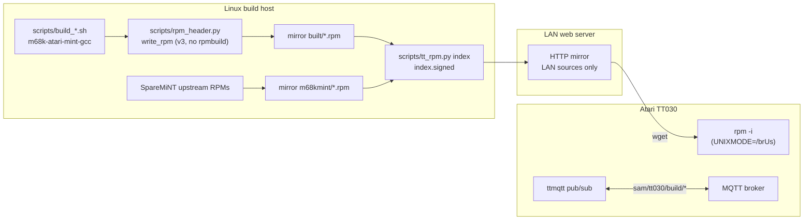
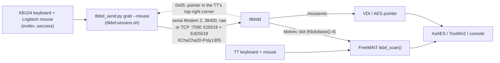

# Atari TT030 & ATW800/2 Transputer Enhancement Project

Management, drivers, custom software, and hardware acceleration utilities for the **Atari TT030 retro-computing workstation** operating within the **SAM (Sensible Agent Management)** ecosystem.

---

## Hardware & System Overview

### Atari TT030 Workstation
The Atari TT030 is a 32-bit Motorola 68030-based workstation running at 32 MHz with an MC68882 FPU, 4 MB ST-RAM, and 64 MB TT-RAM. Equipped with BlueSCSI v2 (Pico 2) storage, BlueSCSI DaynaPORT WiFi local networking, the internal floppy drive and a serial-to-USB link on Modem 2 (38400 baud to a Linux build host: serial console and ZMODEM transfers), the machine serves as a live node within the SAM architecture running TOS 3.06 and FreeMiNT 1.19.

### ATW800/2 Transputer Co-Processor
The ATW800/2 is a VME expansion card with an FPGA that provides fast 2D colour graphics and a **synthetic T425 transputer** (an FPGA implementation of the INMOS 32-bit T425; the card's User's Manual quotes 50+ MHz, and earlier notes in this repo assumed 40 MHz; the clock has not been measured here). The T425 has 5 MB of usable RAM: from T425 address `0x80600000` up is the card's video memory. The 68030 talks to it over the card's link driver (`fpgabios`): about 0.16 ms fixed cost per round-trip and 462 KB/s per direction after this project's driver-call fix.

### Display modes (measured 2026-10-15)
The ATW800/2 drives HDMI through its xVDI driver; the boot mode is set from with `scripts/atw_mode.sh` (a reboot per change) or via the XVDI menu. On the operator's ASUS VS247H-P, 11 vendor modes plus a custom 1920×1080 mono mode display: 800×600 (256 / 65536 colours), 1024×768 (256 / 65536), 1280×720, 1280×800 (256 / 65536), 1280×960, 1280×1024, 1440×960 and 1920×1080 (256 colours), and 1920×1080 mono. Modes below 55 Hz or taller than 1080 lines are out of the monitor's range. **Default: 1920×1080, 256 colours.** At pixel clocks of 108 MHz and above the picture blanks while the T425 runs a job, so in that mode SSH crypto stays on the 68030 (`DROPBEAR_NO_ATW`). Full table, timings and method: [`docs/resolution-management.md`](docs/resolution-management.md).

### TRAM modules (added 2026-10-12)
The card has two sockets for classic TRAMs (TRAnsputer Modules). Both now hold **Transtech TTM15F-45-F** modules, characterised on the real TT (`sam-tram-tt/`):

```
T425 link 1 ── link 3 [Slot-1 TRAM] link 1 ── link 0 [2nd TRAM]      (T425 host link = 0; T425 links 2 and 3 looped)
```

- **CPU:** T4-class, **no FPU**: code built for the T805 FPU (`-t8`) halts both, so they run `-ta`/`-t4` builds. The vendor class suggests a T805; the chip markings are still unread.
- **Speed:** a fixed loop runs at half the T425's speed (30,012 vs 14,743 ticks); bzip2 is 2.8× slower and X25519 2× slower than on the T425. They pay off as extra parallel workers, not as faster processors.
- **Memory:** 4 MB each.
- **Links:** 20 Mbit/s. From the T425: 22 µs fixed cost and 1.58 MB/s per direction to Slot 1; 45 µs and 0.83 MB/s to the 2nd TRAM, which Slot 1 relays (store and forward).

### Project Purpose
The primary purpose of this project is to adapt and modify legacy and modern Unix/C software to run in tandem with the ATW800/2 Transputer. Computationally heavy work (X25519 key exchange, Ed25519 signature verification, ChaCha20, gzip/bzip2 compression) is offloaded to the T425 and the two TRAMs, which frees the 68030. Since 2026-10-13 one daemon, `ttjobd` (`sam-job-tt`), owns the card: it boots a resident image on all three transputers at startup and queues jobs from any number of local programs. Every client falls back to the 68030 when the transputers are unavailable.

## Project Sub-Utilities & Independent Repositories

Each custom software component contains its own dedicated project directory, README, build instructions, and execution documentation:

1. **[`sam-ssh-tt`](sam-ssh-tt/README.md)**: Dropbear SSH server with T425 transputer offload for X25519 key exchange & Ed25519 signature verification (per-login crypto ~25.0 s → ~14.4 s, measured on the TT 2026-09-13). Since 2026-10-13 its crypto goes through `ttjobd` when that daemon runs (X25519 2.8 s, Ed25519 verify 6.5 s on the T425), so a login during a compression job still gets offload.
2. **[`sam-scp-tt`](sam-scp-tt/README.md)** — *README only*: describes an SCP acceleration bridge. There is no code for it in this repo, and none of its claims has been measured.
3. **[`ttmon`](src/ttmon.c)**: Telemetry publisher — retained MQTT `sam/node/telemetry/atari-tt030` every 60 s (the live SAM integration).
4. **[`sam-yum-tt`](sam-yum-tt/README.md)** — **v1.0, working on the real TT**: `yum install | update | remove | list | search | makecache` from the LAN mirror, with a signed index, per-package SHA-256 and build-on-miss for anything the mirror lacks (track `tt030-rpm-pipeline`, all requirements met). Shipped as the `yum-tt` RPM (`src/yum` + `resolve.awk` + `update.awk`).
5. **[`sam-rom-tt`](sam-rom-tt/README.md)** — *alpha skeleton, unproven*: custom (no-TOS) 512 KB firmware for the four ROM sockets, plus the byte-lane interleave tool. Nothing here is proven to run; do not burn from it.
6. **[`ttmqtt`](src/ttmqtt.c)**: Minimal MQTT 3.1.1 `pub` / `sub -W secs` for shell scripts (113 KB). `sub` prints the first message's topic and payload; exit 0 message, 1 timeout, 2 error. Broker by host name, pinned in the TT's `/etc/hosts`. Carries build-on-miss requests and replies.
7. **[`tt_bridge`](tt_bridge/README.md)**: *Superseded by `ttmon` (2026-09-13).* HTTP/1.1 client; replaced by MQTT telemetry.
8. **[`sam-kbd-tt`](sam-kbd-tt/README.md)** — **complete: keyboard and mouse working on the real TT, started at boot**: a Linux PC's keyboard and mouse drive the TT as if they were its own (XaAES, TeraDesk, TosWin2), alongside the physical keyboard. `ttkbdd` injects through FreeMiNT's kbdvec / mousevec paths over a raw serial link or a signed, XChaCha20-Poly1305-encrypted TCP session; one command on the PC, `scripts/ttkbd-session.sh`; the TT's top-right corner hands control back (track `tt030-remote-keyboard`).
9. **[`sam-t425-ports`](sam-t425-ports/README.md)** — faster SpareMiNT userland: CPU-heavy programs rebuilt for the 68030 and, where it measurably wins, offloaded to the T425 (`tbc` 0.19–0.25 of stock bc, `djpeg` 0.37, `lha` 0.46–0.51); every port gated on the real TT, losses recorded.
10. **[`sam-job-tt`](sam-job-tt/README.md)** — **in production on the TT (2026-10-13)**: the transputer job queue. `ttjobd` owns the ATW800/2 link, boots a resident image on the T425 and both TRAMs, and runs jobs (echo, SHA-256, X25519, Ed25519 verify, ChaCha20, and on the T425 deflate/gzip/inflate/bzip2) for local clients over a Unix socket through `libttjob`. It schedules each job by expected finish time across the three nodes (9 bzip2 jobs from 3 clients 1.64× faster than the T425 alone). A watchdog resets and re-boots the network if a node hangs (about 2 s). If a TRAM is missing it boots a smaller image (T425 + TRAM 1, or T425 only) and writes `/var/run/ttjob.topology`. Packaged as the `ttjob` RPM. Op results are checked against host builds under the `t4` emulator.
11. **[`sam-tram-tt`](sam-tram-tt/README.md)**: probes and benchmarks for the two TRAMs: link discovery, the 3-node boot, device id, clock and RAM sizing, the FPU test, link round-trips, and the 68030 ↔ T425 hop and SharedMem measurements.
---

## Software Stack & Subsystem Directory

```
.
├── docs/                      # Technical runbooks, BlueSCSI setup, XBOOT manual & inventory
├── emulator/                  # Hatari workstation emulation configs and HDD image staging
├── scripts/                   # Floppy staging, backup, and emulator integration test harnesses
├── staging/                   # Atari TT formatted floppy & drive C: installation packages
│   ├── AUTO/                  # Driver auto-executables (XBOOT, HDDRIVER, ICD, STiNG)
│   ├── DRIVERS/               # SCSI utility software and disk tools
│   ├── C_ATW800_2/            # ATW800/2 transputer tools, drivers, and runtime server binaries
│   └── TRANSPUTER/            # INMOS T800 Transputer SDK & Helios OS distribution packages
├── src/                       # Custom source code for Atari TT030 co-processing & tooling
│   └── x25519bench/           # Transputer server source, Dropbear offload, and host bridges
├── sam-ssh-tt/                # Transputer-accelerated Dropbear SSH server project & docs
├── sam-scp-tt/                # Transputer-assisted SCP acceleration bridge project & docs
├── sam-rom-tt/                # ALPHA skeleton: custom no-TOS TT030 firmware (512 KB, 4 byte-lane chips)
├── sam-yum-tt/                # the TT-side yum client (+ the T425 SHA-256 probe that ruled out offload)
├── sam-kbd-tt/                # remote keyboard + mouse: README (sources: src/ttkbdd.c, src/kbdinj.c, scripts/ttkbd_send.py, scripts/ttkbd-session.sh)
├── sam-job-tt/                # transputer job queue: ttjobd, libttjob, resident T425 + TRAM images, emulated test lane
├── sam-tram-tt/               # TRAM probes and link benchmarks
├── sam-t425-ports/            # SpareMiNT userland ports with T425 offload
├── packaging/                 # recipes for packaging native TOS/GEM programs as RPMs (bytes come from the TT's disk)
├── recipes/                   # build-on-miss recipe map and fixtures
├── tools/                     # toolchain setup outputs (cross-mint, llvm-t800, INMOS d72uni env); not committed
└── tt_bridge/                 # SAM TT-Bridge HTTP Client C codebase project & docs (TOS/MiNT)
```

---

## Role of SAM (Build, Test, & Deployment Pipeline)

The **SAM (Sensible Agent Management)** platform orchestrated end-to-end development, verification, and live deployment to the Atari TT030:


1. **Cross-Compilation & Build**:
   - Built Motorola 68030 host binaries using `m68k-atari-mint-gcc` (GCC 15.2 cross-compiler, `scripts/setup_cross_mint.sh`) and INMOS ANSI C (`icc`/`ilink` under `t4`) for the T425 transputer server code.
2. **Automated Emulation & Integration Testing**:
   - Hatari runs the package pipeline end to end (`scripts/test_hatari_ping_rpm.sh`, `scripts/test_e2e_ping_rpm.py`); Hatari cannot emulate the ATW800/2, so transputer code is checked under the `t4` emulator against host builds (`sam-job-tt/emu/run_emu_tests.sh`), and every performance gate runs on the real TT.
   - CI (`scripts/ci.sh`) runs on every commit and nightly: host test suites, the emulated lane, the transputer image build, the RPM builds, and a publish gate that sends a new package version to the LAN mirror only from a passing run.
3. **Live Staging & Deployment**:
   - Uploads go over the Modem 2 serial link (ZMODEM, `scripts/tt_zput.sh`, SHA-256 checked); day-to-day access is Dropbear SSH over the DaynaPORT WiFi.
   - Every script logs its run to a local log and a central event.
   - At boot `mint.cnf` starts `ttjobd` (`/etc/rc.ttjobd`) before Dropbear; it replaced the earlier `atwxserv` crypto server.

---

## Package Pipeline (track `tt030-rpm-pipeline`)



| Piece | Where | State (2026-09-22) |
| :--- | :--- | :--- |
| RPM header parser + v3 writer | `scripts/rpm_header.py` | ✅ no `rpm` binary needed; the TT's `rpm -qpi` / `-i` / `-e` / `-V` accept its output |
| Host mirror CLI | `scripts/tt_rpm.py` — `sync`, `index`, `add`, `push`, `keygen`, `synth` | ✅ 420-package signed index; `push` installs to a TT that cannot reach the mirror (ssh, SHA re-checked on the TT) |
| Mirror | static files behind a LAN web server | ✅ answers LAN sources only (remote sources get 403) |
| `yum` client | `sam-yum-tt/src/yum` + `resolve.awk` + `update.awk`, packaged as `yum-tt` | ✅ `install` 47 s (`less`), `update` 35 s (upgraded itself 1.7→1.8), `remove`, `list`, `search`, `makecache` |
| TT tools | `mawk` (cross-built), SpareMiNT `wget`, `src/ttmqtt.c`, `src/ttsign.c` | ✅ all installed as RPMs from the mirror |
| Build-on-miss | `scripts/ttbuildd.py` (a systemd unit on the build host), `scripts/build_recipe.py`, `recipes/source-map.json` | ✅ `yum install pv` with pv absent → built + installed, 1 m 47 s; no recipe → queued + board card; build error → `failed`; broker down → exit 1 |
| Recipes | `pv` 1.7.24, `xz` 5.8.4 | ✅ two clean builds give the same stripped binary (NFR-3) |
| rpm DB backfill | `scripts/rpm_va_classify.py` | ✅ `rpm -Va` classified: 0 real drift |
| Offline rpm DB writer | `scripts/tt_rpmdb.py` (`check`, `add`) + `scripts/tt_db1tool.c` (real db1.85) | ✅ 2026-10-10: wrote mintlib + ncurses into card 2 (TT's rpm verified the result in Hatari) |
| rpm >64 KB fix | `rpm-3.0.6-4.sam2` (`wcpu_repack.py --suffix`, `mint_stack.py` on stripped binaries) | ✅ 2026-10-10: the sam1 rebuild had lost its 256 KB stack; sam2 = 512 KB, on the mirror |
| Native TOS/GEM → FHS | `scripts/tt_tospkg.py` + `packaging/*.json` (bytes from the card's HD00, never git) | 🟡 2026-10-10: six `/opt/<app>` RPMs on the LAN mirror, Hatari-tested; real TT pending (PMS `tt030-fhs-layout`) |
| Job-queue packages | `sam-job-tt/build_rpm.sh` (`ttjob`), `scripts/build_t425_compress.sh` (`t425-compress` 1.6, through `ttjobd`) | ✅ 2026-10-13: both rebuild byte-identical; CI publishes a new version only from a passing run |
| Card image | `scripts/build_hd10_ext2.sh` + `staging/SAM_RPMS/` | ✅ rebuilt with the yum tools; **not boot-tested** (needs an SD flash) |

### FreeMiNT rpm / yum package management

The TT runs SpareMiNT's **rpm 3.0.6** (2001) against a modern mirror. What that costs:

- **`UNIXMODE` is load-bearing.** Without it mintlib opens files in text mode and turns CRLF into LF:
  `openssl` prints wrong digests, `rpm -i` dies with `cpio: read`, and `rpm -V` reports false MD5
  mismatches. The kernel sets `/brUs` at boot, but Dropbear cleared it for ssh sessions until
  `rc.dropbear` gained `-e`. `yum` re-exports it defensively.
- **`rpm --root` is not a sandbox.** SpareMiNT patches `chroot()` to `chdir()`, so only the database
  moves and files land at their real paths.
- **`RPMVERSION` must be in the header,** or rpm 3.0.6 on a big-endian host verifies with its "broken
  MD5" routine and flags every file. `write_rpm` writes it.
- **No `rpmbuild`.** Packages are written byte-wise by `rpm_header.write_rpm`: v3 lead (arch 13, OS 255),
  flat `FILENAMES`, gzip cpio whose names carry no `./`, symlinks as MiNT's `S_IFLNK` **0160777**.
- **`yum` runs under bash,** because the TT's `/bin/sh` is a minimal bash build with no `kill` builtin.
- **Integrity:** the client reads one file, `index.signed` = RSA signature + index, so a GET can never
  pair a new index with an old signature; its `#serial` line must not go backwards (replay), and every
  package's SHA-256 is checked before a plain `rpm -i` (never `--force`). Build requests are Ed25519-signed
  by the card (`ttsign`), since the estate broker is anonymous and classic mosquitto ACLs cannot deny one
  topic.
- **Speed, measured on the 68030:** `makecache` ~18 s · `yum install less` ~47 s · `rpm -Va` ~16 min ·
  RSA-2048 signing 2 m 29 s (hence Ed25519 at ~2.7 s) · `xz -6` fails for want of ~94 MB RAM (use `-0`..`-3`).
- **Housekeeping:** the card has no `wheel` group, so package files were `chgrp`'d to a new one; the two
  `gzip` symlinks cannot follow (MiNT has no `lchown`). Providers such as `base`, `initscripts`,
  `freemint-net` and `gawk` are deliberately not installed: they would overwrite `/etc`, replace the boot
  scripts, pull the kernel package, or collide with mawk's `/usr/bin/awk`.


*Superseded:* `scripts/sam_tt030_rpm_builder.py` and the `ping` spec workflow (`rpmbuild`-based, pre-plan) were not used; the plan requires the dependency-free writer above.

---

## Remote Keyboard and Mouse (track `tt030-remote-keyboard`)



| Piece | Where | State (2026-09-23) |
| :--- | :--- | :--- |
| Injection path | `src/kbdinj.c` (spike), `src/ttkbdd.c` | ✅ same path as the hardware key; both keyboards merge |
| Key table swap (remote `;` `[`) | `Ssystem(S_LOADKBD)` in `ttkbdd` | ✅ unpatched UK table during a session, space remap restored after |
| Encrypted session | `ttkbdd` listener + `scripts/ttkbd_send.py` | ✅ forged / tampered / replayed input never typed; 3 s silence releases keys |
| Reliability / CPU | 2,700-key runs at 15 keys/s; ttkbdd CPU at 10 keys/s | ✅ 1 key lost in 8,100 (target ≤ 1 in 5,000); ✅ WiFi CPU 10.2 % (accepted vs 10 %), serial 9.3 % |
| Raw serial (D4) | `ttkbdd -S` exec'd from the Modem 2 console; `ttkbd_send.py --serial` | 🟡 9.3 % CPU; 600/600 keys; 2,690/2,700 at 15 keys/s; latency median 6 ms |
| Mouse | `mousevec` injection, protocol v3 frames, `--mouse` | ✅ exact motion (4 px/unit), TT hot corner hands back; operator-confirmed live |
| One command | `scripts/ttkbd-session.sh` (serial default, `--wifi`) | ✅ restores the Modem 2 console on the chord or hot corner |
| PC capture | `ttkbd_send.py grab`, `scripts/ttkbd-session.sh`, a udev uaccess rule | ✅ operator confirmed the live session works (2026-09-23) |
| Start at boot | `/etc/rc.ttkbdd` + `mint.cnf` exec line | ✅ on the card; after a reboot ttkbdd was PID 19, listening |

Details, results and run instructions: [`sam-kbd-tt/README.md`](sam-kbd-tt/README.md).

---

## Hardware Profile
- **CPU / FPU**: Motorola MC68030 @ 32 MHz · MC68882 FPU
- **Memory**: 4 MB ST-RAM · 64 MB TT-RAM
- **Storage**: BlueSCSI v2 (Pico 2) SCSI ID 0 (`HD00_512.hda`, FAT16) and SCSI ID 1 (`HD10_512.hda`, 1 GiB Ext2 RAW)
- **Networking**: BlueSCSI DaynaPORT WiFi · serial SLIP on Modem 2
- **Co-Processor**: ATW800/2 card: synthetic (FPGA) T425 transputer with 5 MB usable RAM, 2D graphics core
- **TRAMs**: two Transtech TTM15F-45-F in the card's TRAM sockets: T4-class, no FPU, 4 MB each, half the T425's loop speed

---


